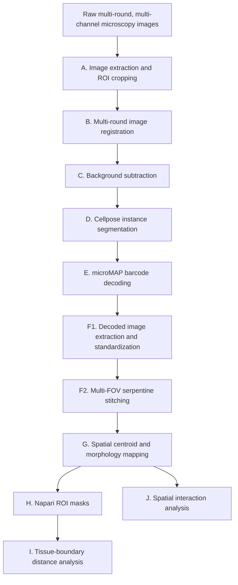

# microMAP Spatial Microbiome Analysis Pipeline

A hybrid MATLAB/Python workflow for multi-round fluorescence image preprocessing, bacterial instance segmentation, combinatorial barcode decoding, multi-FOV reconstruction, tissue-boundary distance mapping, and multiscale spatial ecology analysis.

The repository contains 11 analysis scripts. Together with this `README.md`, the GitHub root directory contains 12 files.

## Workflow Overview



The filename prefix indicates the recommended execution order. F1 and F2 are consecutive substeps of the same reconstruction stage. Steps H and I form an optional tissue-boundary analysis branch, while J reads the centroid table generated by G.

## Repository Structure

```text
.
├── README.md
├── a_batch_extract_multichannel_images.m
├── b_image_registration_pos.py
├── c_Batch_Background_Subtraction.m
├── d_cellpose_batch_segmenter.py
├── e_imaging_decode.m
├── f_1_extract_decoded_images.m
├── f_2_batch_stitch_images.m
├── g_spatial_centroid_mapper.py
├── h_napari_roi_converter.py
├── i_boundary_distance_analyzer.py
└── j_spatial_interaction_analyzer.py
```

## Main Features

- Multi-round brightfield-guided translational registration with two-pass displacement rescue.

- Channel- and round-specific fluorescence background subtraction.

- Fine-tuned Cellpose segmentation with boundary refinement for touching bacterial cells.

- Single-cell microMAP barcode decoding using fluorescence statistics and Hamming-distance correction.

- Conversion of decoded strain layers into a zero-based channel convention.

- Serpentine multi-FOV stitching with maximum-intensity overlap blending.

- Cell-level centroid, area, and equivalent-diameter extraction.

- Napari ROI conversion into filled and contour masks.

- Feature-based dual-ROI registration and KD-tree boundary-distance calculation.

- Microscale interactions, self-aggregation, mesoscale neighborhood profiling, UMAP/Leiden clustering, and interaction-network visualization.

## Requirements

### MATLAB

MATLAB R2022a or newer is recommended.

Required or potentially required toolboxes:

- Image Processing Toolbox

- Parallel Computing Toolbox

- Statistics and Machine Learning Toolbox

- Computer Vision Toolbox

The Computer Vision Toolbox is required by `insertText` in the decoding visualization stage.

### Python

Python 3.9 or newer is recommended.

Install the core dependencies with:

```bash
pip install numpy pandas scipy scikit-image scikit-learn \
    opencv-python tifffile matplotlib seaborn networkx \
    joblib tqdm pystackreg cellpose
```

Install the advanced mesoscale-clustering dependencies with:

```bash
pip install umap-learn python-igraph leidenalg
```

`tkinter` is used for native directory-selection dialogs and is commonly bundled with standard Python installations. On some Linux systems it must be installed separately.

### External Experimental Files

The scripts also require experiment-specific assets that are not part of the 11-script repository:

- A fine-tuned Cellpose model, currently referenced as `cpsam_20250730_095145`.

- A barcode codebook, currently referenced as `code_11.xlsx`.

- A Napari-exported ROI JSON file containing a top-level `polygons` array.

- Tissue reference images used for ROI registration and distance analysis.

## Input Data Organization

### Raw Microscopy Directory

Step A expects a two-level folder hierarchy:

```text
raw_root/
├── sample_or_round_0/
│   ├── Pos1/
│   │   ├── ...Channel1...tif
│   │   ├── ...Channel2...tif
│   │   └── ...
│   ├── Pos2/
│   └── ...
├── sample_or_round_1/
│   ├── Pos1/
│   └── ...
└── ...
```

The first-level folder name and second-level position name are combined when the cropped TIFF files are exported. To remain compatible with Step B, the flattened filenames must follow this general structure:

```text
<prefix>_<round>_Pos<position>_<channel>.tif
```

Example:

```text
SPF_colon_0_Pos1_bright.tif
SPF_colon_0_Pos1_647_705-72.tif
SPF_colon_1_Pos1_bright.tif
```

## Execution Guide

### A. Image Extraction and ROI Cropping

#### Script

`a_batch_extract_multichannel_images.m`

#### Purpose

Traverses the nested raw-data folders, identifies six configured acquisition channels, crops a common ROI, and exports flattened TIFF files with standardized channel names.

#### Configure before running

- `target_roi`
- `channel_map`

The current ROI is expressed as:

```text
[xmin, ymin, width, height]
```

#### Input

Nested raw microscopy folders.

#### Output

```text
<prefix>_<round>_Pos<position>_<channel>.tif
```

The script uses `parfor` to process FOV folders in parallel.

### B. Multi-Round Image Registration

#### Script

`b_image_registration_pos.py`

#### Purpose

Registers each imaging round using the brightfield channel and applies the resulting translational transform to all fluorescence channels from the same round.

#### Method

- Round N is aligned to round N-1.

- PyStackReg estimates translational displacement.

- A two-pass procedure detects outlier FOVs and replaces failed displacement estimates with round-level averages.

- Registered data are clipped and exported as `uint16`.

#### Expected input naming

```text
<prefix>_<round>_Pos<position>_<channel>.tif
```

#### Main outputs

```text
registered_<original_filename>.tif
registration_displacements_detailed.csv
registration_round_averages.csv
registration_recorrection_info.csv
```

The last file is only generated when recorrection is required.

**⚠️ Important Post-Registration Step (Fiji Cropping):**

Due to translational shifts during the multi-round registration process, the aligned images will exhibit empty or padded margins at the edges. Before proceeding to Step C, you must use **Fiji (ImageJ)** to evaluate the maximum displacement across rounds and uniformly crop all registered images down to **w = 1260; h = 1260**. This manual cropping removes the irregular registration borders and provides a clean, standardized Field of View for downstream background subtraction and single-cell decoding.

### C. Background Subtraction

#### Script

`c_Batch_Background_Subtraction.m`

#### Purpose

Uses a designated terminal imaging round as a background reference and subtracts channel- and round-specific background contributions from the fluorescence stacks.

#### Configure before running

- `num_pos`
- `num_round`
- `bkg_round_idx`
- `file_prefix`
- `channel_name`
- `bkgChannelRatio`
- `bkgRoundRatio`

The current script treats channels 1–5 as fluorescence channels and channel 6 as brightfield. Brightfield is passed through without background-subtracted export.

#### Input

Registered TIFF images.

#### Main outputs

```text
<input_folder>_SUB_Background/
├── Background_parameters.csv
└── registered_<prefix>_<round>_Pos<position>_<fluorescence_channel>.tif
```

`Background_parameters.csv` records the selected background round and correction ratios.

### D. Cellpose Instance Segmentation

#### Script

`d_cellpose_batch_segmenter.py`

#### Purpose

Segments bacterial instances from the configured `647_705-72` channel using a fine-tuned Cellpose model.

#### Configure before running

- `pretrained_model`
- `processing_params`
- `pattern`

The script asks whether GPU acceleration should be used.

#### Input

Background-corrected TIFF images whose names end with:

```text
_647_705-72.tif
```

#### Output

A timestamped directory containing PNG instance masks:

```text
cellpose_masks_<date>/
└── <source_filename>.png
```

A custom post-processing function enforces a narrow separation between adjacent instance labels.

### E. microMAP Barcode Decoding

#### Script

`e_imaging_decode.m`

#### Purpose

Quantifies single-cell fluorescence across hybridization rounds, validates signals against local and global backgrounds, resolves combinatorial barcodes against a codebook, and produces strain-specific spatial images.

#### Configure before running

- `x, y, w, h`
- `ActualStrainNum`
- `BkgNoise`
- `global_bkg_ratio`
- `local_bkg_ratio`
- `CorrBit`
- `bkg_box`
- `Index`
- `numImages`
- codebook path

The current implementation uses 11 rounds and five fluorescence channels.

#### Input

- Background-corrected fluorescence TIFF files.

- Cellpose PNG masks from Step D.

- An Excel barcode codebook.

#### Per-position output

```text
<decode_results>/
└── Pos<position>/
    ├── Decode.csv
    ├── Acquired_code.txt
    ├── Mode.csv
    ├── bacteriaCounts.csv
    ├── BW_labels.tif
    ├── StrainImage1_Strain1.tif
    ├── StrainImage2_Strain2.tif
    ├── ...
    ├── StrainImage<N>_Unknown.tif
    ├── StrainImageAll.tif
    ├── ColorStrainImageAll.tif
    └── FinalColorStrainImageAll.tif
```

The script also generates experiment-wide count and barcode-matching summaries.
#### This step can be finished by BacUnet decoding network.


### F1. Decoded Image Extraction and Standardization

#### Script

`f_1_extract_decoded_images.m`

#### Purpose

Collects strain-specific TIFF images from the `Pos*` decoding folders and converts the one-based strain identifiers into a zero-based channel convention.

#### Naming conversion

| Original filename | Standardized filename |
| --- | --- |
| `StrainImage1_Strain1.tif` | `stacked_Pos1_channel_0.tif` |
| `StrainImage2_Strain2.tif` | `stacked_Pos1_channel_1.tif` |

The zero-based channel convention is intentional:

| Channel | Biological identifier |
| --- | --- |
| `channel_0` | `bacteria_id 1` |
| `channel_1` | `bacteria_id 2` |

Special decoding layers are retained as:

```text
stacked_Pos<position>_Unknown.tif
stacked_Pos<position>_StrainImageAll.tif
stacked_Pos<position>_ColorStrainImageAll.tif
```

#### Output

```text
<decode_results>_stacked/
```

This directory is the input to Step F2.

### F2. Multi-FOV Serpentine Stitching

#### Script

`f_2_batch_stitch_images.m`

#### Purpose

Reconstructs full spatial mosaics from standardized FOV tiles.

#### Method

- Detects all layers matching `stacked_Pos*.tif`.

- Sorts tiles numerically by `Pos`.

- Reverses even rows to reproduce serpentine acquisition.

- Joins rows from bottom to top.

- Uses maximum-intensity blending in overlap regions.

#### Configure before running

- `overlap_ratio`
- `num_rows`

`num_rows` must match the physical acquisition grid.

#### Input

```text
stacked_Pos<position>_<layer>.tif
```

#### Output

```text
stitched_results/
├── channel_0_stitched.tif
├── channel_1_stitched.tif
├── ...
├── Unknown_stitched.tif
├── StrainImageAll_stitched.tif
└── ColorStrainImageAll_stitched.tif
```

### G. Spatial Centroid extract

#### Script

`g_spatial_centroid_mapper.py`

#### Purpose

Extracts connected bacterial objects, centroid coordinates, object areas, and equivalent diameters from the stitched strain layers.

#### Expected input naming

```text
channel_<zero_based_id>_stitched.tif
```

The biological identifier is calculated as:

```python
bacteria_id = channel_id + 1
```

#### Configure before running

- `input_directory`
- `output_directory`
- `pixel_size`

#### Main outputs

```text
labels_centroids.tif
labels_area_overlay.tif
labels_centroids.csv
combined_report.txt
```

The centroid table contains:

- `bacteria_id`
- `cell_id`
- `centroid_row`
- `centroid_col`
- `area_pixels`
- `area_um2`
- `equivalent_diameter`
- `equivalent_diameter_um`
- `global_cell_id`

### H. Napari ROI Annotation Conversion

#### Script

`h_napari_roi_converter.py`

#### Purpose

Converts Napari-exported polygon or line coordinates into full-resolution filled and contour masks aligned with a reference TIFF image.

#### Expected JSON structure

```text
{
  "polygons": [
    [[y1, x1], [y2, x2], [y3, x3]]
  ]
}
```

Napari coordinates are interpreted as `[Y, X]` and converted to OpenCV `[X, Y]` coordinates.

#### Configure before running

- `data_dir`
- `img_filename`
- `json_filename`
- `connection_tolerance`

#### Outputs

```text
<reference>_roi_filled_mask_cv2_merged.tif
<reference>_roi_filled_mask_cv2_merged.npy
<reference>_roi_contour_mask_cv2_merged.tif
<reference>_roi_contour_mask_cv2_merged.npy
```

The contour mask is used to build the boundary KD-tree in Step I. The filled mask is used to determine whether transformed centroids fall inside the annotated tissue region.

### I. Tissue-Boundary Distance Analysis

#### Script

`i_boundary_distance_analyzer.py`

#### Purpose

Maps bacterial centroid coordinates into a macroscopic tissue coordinate system and calculates the nearest distance from each bacterium to the annotated tissue contour.

#### Method

- Reads the centroid label map generated by Step G.

- Uses ORB, SIFT, or AKAZE feature matching when the bacterial and tissue images have different spatial dimensions.

- Extracts translational offsets from the estimated homography.

- Builds a chunked `cKDTree` from the tissue contour.

- Calculates nearest-boundary distances in pixels and micrometers.

- Uses the filled tissue mask to flag centroids outside the annotated specimen.

#### Configure before running

- `pixel_size_um`
- `centroid_map_path`
- `boundary_mask_path`
- `filled_mask_path`
- `decoded_image_path`
- `full_image_path`
- `roi_decoded`
- `roi_full`

ROI values use:

```text
(x_start, y_start, x_end, y_end)
```

#### Main outputs

```text
<centroid_map>_all_bacteria.csv
<centroid_map>_all_strains_summary.csv
<centroid_map>_all_strains_summary_meta.csv
<centroid_map>_distance_statistics.png
<centroid_map>_match_verification_lines.jpg
```

Per-bacteria text reports are also generated.

### J. Spatial Interaction and Mesoscale Community Analysis

#### Script

`j_spatial_interaction_analyzer.py`

#### Purpose

Performs multiscale spatial ecology analysis using the centroid CSV generated by Step G.

#### Analytical modules

##### Microscale heterotypic interactions

- KD-tree proximity pairs.

- Label-permutation null distributions.

- Observed and expected pair counts.

- Enrichment, depletion, and two-tailed permutation p-values.

##### Homotypic self-aggregation

- Per-bacteria DBSCAN clustering.

- Clustered-cell fraction.

- Random-label baseline and normalized clustering strength.

##### Mesoscale neighborhoods

- Hexagonal sampling of circular spatial neighborhoods.

- Multi-radius density and composition matrices.

- UMAP embedding or PCA fallback.

- Leiden community detection or K-Means fallback.

##### Interaction networks

- Significant cross-bacteria associations.

- Enrichment/depletion network visualization.

#### Required centroid columns

- `bacteria_id`
- `centroid_col`
- `centroid_row`

#### Configure before running

- `centroid_analysis_dir`
- `pixel_to_um`
- `interaction_radius_um`
- `self_cluster_eps_um`
- `mesoscale_min_radius_um`
- `mesoscale_max_radius_um`
- `mesoscale_step_um`
- `mesoscale_density_threshold_per_1000_um2`
- `mesoscale_overlap_ratio`
- `microscale_randomizations`
- `selfcluster_randomizations`
- `random_seed`
- `use_advanced_clustering`
- `k_neighbors`
- `resolution`

Advanced clustering requires all of the following:

- `umap-learn`
- `python-igraph`
- `leidenalg`

Set `use_advanced_clustering=False` when those dependencies are unavailable.

#### Representative outputs

```text
interaction_analysis_parameters.json
microscale_interactions.png
microscale_interactions_summary.csv
self_clustering_analysis.png
self_clustering_summary.csv
cross_species_network.png
mesoscale_neighborhoods_matrix.csv
mesoscale_embedding_clusters.png
mesoscale_cluster_profiles_mean_density.csv
mesoscale_cluster_profiles_relative_abundance.csv
interaction_summary.txt
```

Radius-specific mesoscale maps are written to separate subdirectories.

## Critical Naming Contracts

The pipeline depends on consistent filenames. The main contracts are:

| Connection | Required naming or input |
| --- | --- |
| A → B | `<prefix>_<round>_Pos<position>_<channel>.tif` |
| B → C | `registered_<prefix>_<round>_Pos<position>_<channel>.tif` |
| D → E | mask filenames must contain `Pos<position>_` |
| E → F1 | `Pos<position>/StrainImage<id>_Strain<id>.tif` |
| F1 → F2 | `stacked_Pos<position>_channel_<zero_based_id>.tif` |
| F2 → G | `channel_<zero_based_id>_stitched.tif` |
| G → J | `*_centroids.csv` containing `bacteria_id`, `centroid_row`, `centroid_col` |
| G + H → I | `labels_centroids.tif` plus filled and contour ROI masks |

Do not remove the `Pos`, `channel_`, or `_stitched` tokens unless the corresponding regular expressions are updated.

## Recommended Parameter Checklist

Before analyzing a new experiment, verify:

- ROI crop coordinates in Step A.

- Raw channel suffixes and output channel names in Step A.

- Round and `Pos` filename structure used by Step B.

- FOV count, round count, background round, prefix, and subtraction ratios in Step C.

- Cellpose model path and inference parameters in Step D.

- Codebook path, ROI, target count, background thresholds, round count, and Hamming correction in Step E.

- Stitching overlap and acquisition-grid row count in Step F2.

- Physical pixel size in Steps G, I, and J.

- Napari JSON coordinate structure and connection tolerance in Step H.

- Dual-ROI coordinates and tissue-reference files in Step I.

- Spatial radii, permutation counts, density threshold, and clustering settings in Step J.

Use the same physical pixel size in all spatial modules.

## Suggested GitHub Layout

For a more portable release, the scripts can later be organized as:

```text
.
├── README.md
├── matlab/
│   ├── a_batch_extract_multichannel_images.m
│   ├── c_Batch_Background_Subtraction.m
│   ├── e_imaging_decode.m
│   ├── f_1_extract_decoded_images.m
│   └── f_2_batch_stitch_images.m
├── python/
│   ├── b_image_registration_pos.py
│   ├── d_cellpose_batch_segmenter.py
│   ├── g_spatial_centroid_mapper.py
│   ├── h_napari_roi_converter.py
│   ├── i_boundary_distance_analyzer.py
│   └── j_spatial_interaction_analyzer.py
├── models/
├── codebook/
└── example_data/
```

The current A-to-J filename prefixes should be retained because they act as a built-in execution map.

## Reproducibility Notes

- Several scripts contain experiment-specific absolute paths or fixed parameters in their main execution blocks. Update these before running on another computer.

- Step C writes its correction parameters to CSV.

- Step B exports displacement and recorrection metadata.

- Step G writes a centroid report containing pixel calibration.

- Step I exports spatial registration and distance summaries.

- Step J serializes its analysis parameters to JSON.

- Large images may require substantial RAM and disk space even where memory mapping or lazy loading is used.

- Monte Carlo permutation counts directly affect runtime and p-value resolution.

- The stitching procedure assumes that numerical `Pos` order corresponds to the physical serpentine acquisition order.
